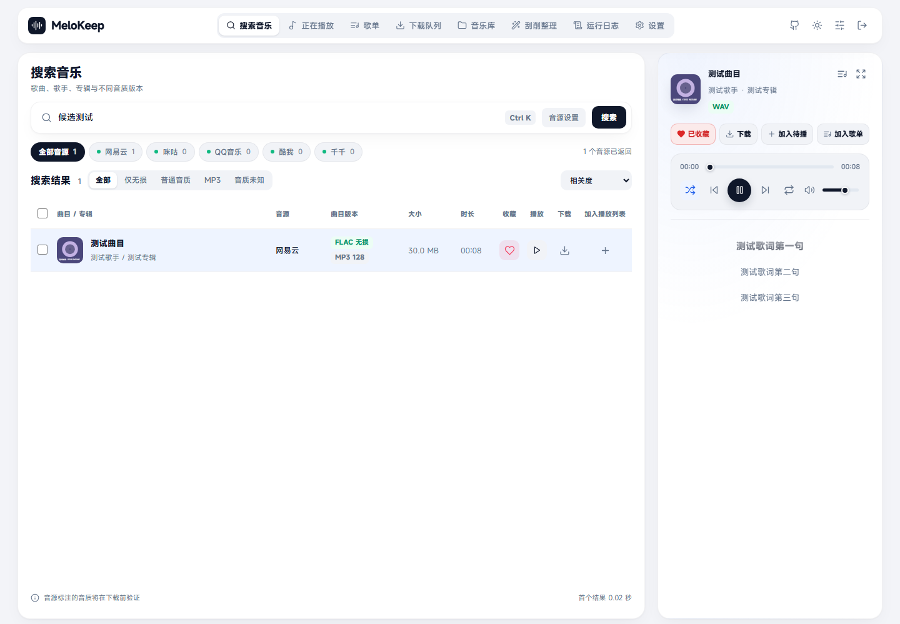
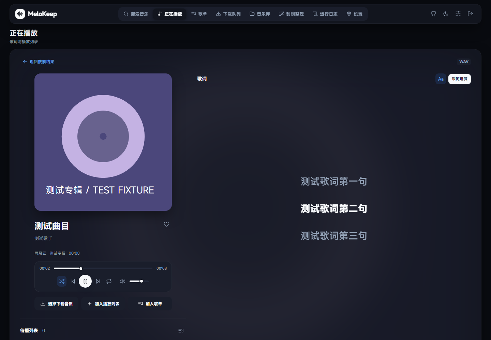
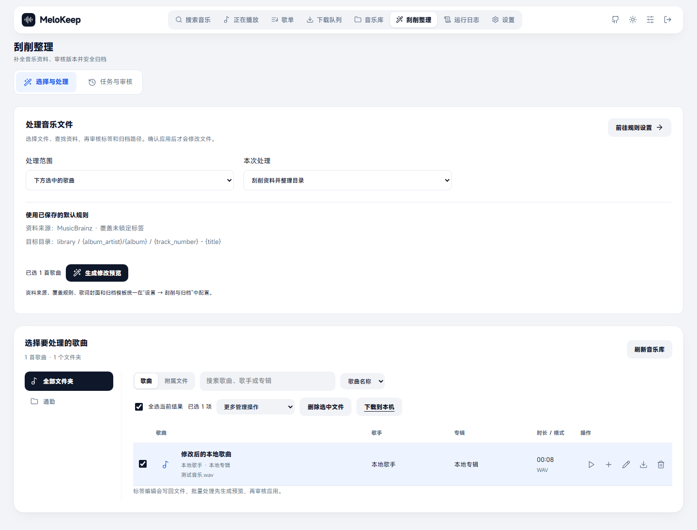
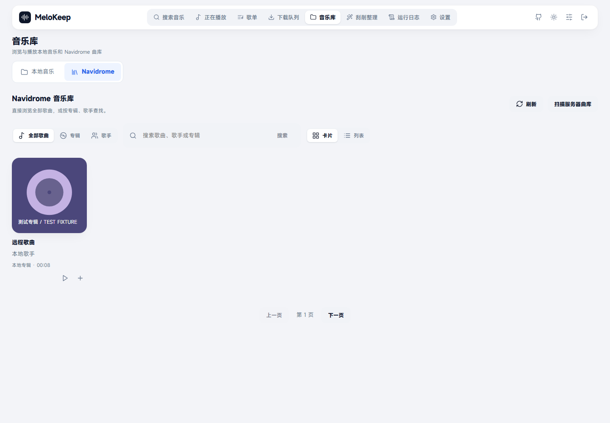
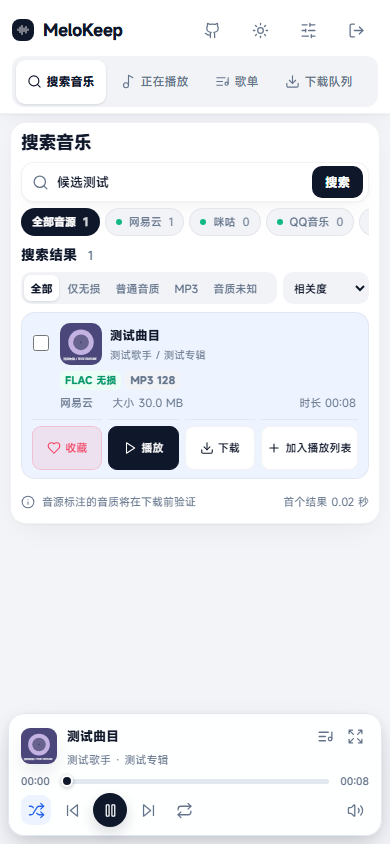
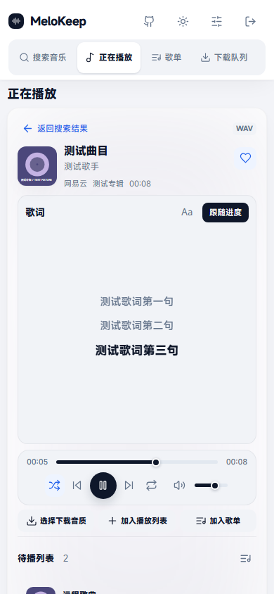
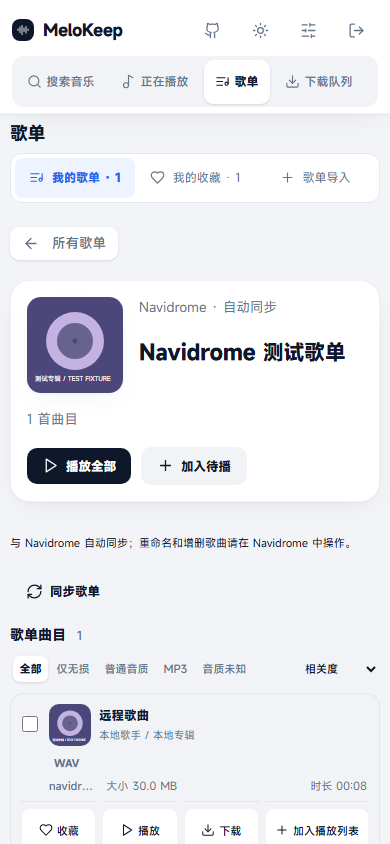

# MeloKeep

**把音乐搜索、播放、下载、歌单与曲库整理放在一起的自托管音乐工作台。**

MeloKeep 面向 NAS、家庭服务器和本机音乐收藏场景：从多个音源寻找音乐，试听并下载原文件，为已有音乐补全标签、歌词与封面，按规则整理成自己的音乐库。连接 Navidrome 后，还可以在同一界面浏览远程曲库、同步歌单和播放歌曲。

支持桌面和手机浏览器、浅色与深色主题，以及 Telegram、企业微信交互式下载和飞书、钉钉、Discord 下载通知。

[界面预览](#界面预览) · [功能介绍](#功能介绍) · [Docker 部署](#docker-部署) · [刮削与整理](#刮削与整理) · [Navidrome](#navidrome-连接) · [Telegram 大文件发送](#telegram-local-bot-api-server) · [配置文档](docs/configuration.md)

## 界面预览

以下图片来自实际运行的 MeloKeep，使用演示歌曲、封面和任务数据。点击图片可查看原图。

### 桌面端

搜索结果、音质筛选和侧边播放卡片：



<details>
<summary>查看深色播放器、刮削整理和 Navidrome 曲库</summary>

歌词随播放进度滚动，也可点击歌词跳转：



独立的刮削整理工作台，选曲、预览、审核与应用：



Navidrome 歌曲支持列表和卡片视图：



</details>

### 移动端

<table>
  <tr>
    <th>搜索与播放卡片</th>
    <th>同步歌词播放器</th>
    <th>Navidrome 歌单</th>
  </tr>
  <tr>
    <td></td>
    <td></td>
    <td></td>
  </tr>
</table>

## 功能介绍

### 搜索、试听与下载

- 使用上游 [CharlesPikachu/musicdl](https://github.com/CharlesPikachu/musicdl) 引擎搜索和解析音乐，可选择音源，配置 Cookie、代理和请求参数。
- 增量显示搜索结果，支持音源筛选、无损 / 普通音质 / MP3 / 音质未知筛选，以及大小、品质、时长、曲名等排序。
- 搜索默认解析可用的格式和文件大小；也可开启“按需解析”，先展示候选，播放或下载时再获取版本信息。
- 在线播放、进度拖动、音量和静音、随机和循环播放、待播列表、歌词跟随。LRC 歌词可点击跳转，并可调整显示大小。
- 单曲和批量下载共用下载队列，可暂停、继续、取消和移除记录。上游支持 HTTP Range 且校验通过时续传，否则重新下载。
- 可用版本受到登录状态、地区、平台权限和网络影响，下载前会验证实际版本。

### 歌单与收藏

- 在“歌单”中统一管理自建歌单、我的收藏和平台歌单导入。
- 搜索结果和当前播放曲目可加入歌单、收藏或待播列表，支持整张歌单播放和批量操作。
- 导入外部歌单链接或 ID；未导入曲目显示原因，可换源搜索。
- 自动导入已连接 Navidrome 账号可见的歌单，并支持手动同步。远程歌单在 MeloKeep 中只读，重命名和增删歌曲请在 Navidrome 中操作。

### 本地与远程音乐库

- 浏览本地目录、筛选并播放已有歌曲，查看文件格式、大小、时长与元数据。
- 本地曲目选中后可送往“刮削整理”，将曲库浏览与修改文件分开。
- Navidrome 支持直接显示所有歌曲，也可按专辑、歌手浏览；歌曲和专辑支持列表 / 卡片切换。
- Navidrome 歌单的音质筛选和品质排序读取原文件格式与码率，FLAC、MP3 等已知格式不会因下载版本列表为空而被归入未知。
- 远程歌曲可播放或下载原文件；修改远程库的标签与目录，需要通过服务器上的本地音乐目录处理。

### 刮削、标签与归档

- 独立的“刮削整理”工作台：选择歌曲与操作 → 生成修改预览 → 审核候选、标签差异和路径 → 确认应用。
- 多来源补全标题、歌手、专辑、日期、曲序、碟号、歌词和封面，支持 MusicBrainz 发行资料与 AcoustID 音频指纹识别。
- 单曲和批量编辑文字标签、歌词与封面；手动修改字段可锁定，避免后续刮削覆盖。
- 按模板归档和重命名，从文件名提取标签，文本替换、繁简转换和部分乱码修复。
- 歌词与封面导入导出、艺术家图片、重复歌曲报告、完整解码检查、音频转码及 CUE 分轨。
- “下载后自动刮削”“下载后自动整理”可分别开启；支持监控目录，文件写入稳定后自动处理或生成预览。
- 保存处理历史、原文件备份和恢复版本，可审核、恢复并导出报告。

### 机器人与通知

| 渠道 | 功能 |
| --- | --- |
| Telegram | 私聊搜索、翻页、选曲下载和查看任务，向聊天发送原音频或文件；支持本地 Bot API 大文件发送 |
| 企业微信自建应用 | 应用会话内搜索、选曲、管理任务，交付文件或链接 |
| 飞书 / Lark | 群 Webhook 下载完成、失败、取消通知及文件链接 |
| 钉钉 | 群 Webhook 下载结果通知，支持加签 |
| Discord | 群 Webhook 下载结果通知 |

网页和机器人共用下载队列。Telegram、企业微信可以在保存前测试连接，测试不会发送消息。运行状态以绿色标签表示已启用、灰色表示未启用，保存生效后更新。

### 界面与设置

- 顶部栏目可拖动排序，也可用右上角排序按钮调整，支持手机操作。
- 右上角统一放置项目地址、主题、排序与退出图标。
- 浅色、深色和跟随系统主题；导航顺序、主题与部分浏览方式保存在当前浏览器。
- 音源、刮削默认规则、Navidrome 连接和通知渠道统一在“设置”中管理。
- 运行日志按类别和级别筛选，可查看原始错误及导出。

## Docker 部署

镜像为 `ghcr.io/agonie0v0/melokeep:latest`，发布目标包含 `linux/amd64` 和 `linux/arm64`。镜像内置 FFmpeg、Chromaprint / fpcalc 和官方 `telegram-bot-api`，无需额外部署刮削服务。

### 1. 创建 Compose

在 NAS 或服务器创建部署目录，保存下面的 `docker-compose.yml`。修改登录密码后再启动；仓库也提供[同名示例文件](docker-compose.yml)。

```yaml
services:
  melokeep-webui:
    container_name: melokeep
    image: ghcr.io/agonie0v0/melokeep:latest
    restart: unless-stopped
    init: true
    ports:
      - "8765:8765"
    volumes:
      - ./music:/music
      - ./data:/data
    environment:
      MELOKEEP_USER: admin
      MELOKEEP_PASS: '请改成你自己的强密码'
      # NAS 有专用读写用户时，按实际 UID/GID 取消注释：
      # PUID: '1000'
      # PGID: '1000'
```

```sh
mkdir -p music data
docker compose up -d
```

浏览器访问 `http://服务器IP:8765` 并登录。密码在 Compose 中包含 `$` 时写成 `$$`，避免被当作变量。

### 2. 保留持久化数据

| 宿主机目录 | 容器路径 | 内容 |
| --- | --- | --- |
| `./music` | `/music` | 下载文件、整理后的曲库、歌词和封面等附属文件 |
| `./data` | `/data` | 配置、数据库、歌单收藏、任务记录、处理备份与 Telegram 本地服务数据 |

已有音乐可放入或挂载到 `/music` 下。默认整理目录 `library` 对应 `/music/library`，整理目标须位于音乐根目录内。

容器启动时初始化挂载目录权限，再以 `PUID:PGID` 运行，默认 `10001:10001`。NAS 有专用用户时，用 `id 用户名` 查询 UID/GID 后填入 Compose。

### 3. 更新与查看日志

```sh
docker compose pull
docker compose up -d
docker compose logs -f --tail 100
```

更新时保留两个挂载目录。`latest` 在镜像发布流程成功后更新，也可用 `sha-完整提交号` 标签固定版本。

## 首次使用

1. **设置 → 音源与下载**：选择音源，按需配置 Cookie、代理、搜索数量与下载偏好。
2. **搜索音乐**：搜索、试听、选择版本并下载，在“下载队列”查看进度。
3. **设置 → 刮削与归档**：选择资料来源、覆盖规则、歌词封面保存方式和整理模板，保存设置。
4. **刮削整理**：选择已有音频，生成预览，在“任务与审核”确认后应用；先用少量歌曲确认规则。
5. **设置 → Navidrome 连接**：连接已有服务器，在“音乐库”和“歌单”中浏览。
6. **设置 → 通知与机器人**：按需要配置私聊机器人或群通知。

下载后自动刮削与整理初始关闭，可以单独启用。浏览音乐库不会自动修改历史文件。

## 刮削与整理

### 资料来源

下载音源和刮削来源分别配置，具体可补字段以来源实际返回为准。

| 来源 | 主要资料 | 使用说明 |
| --- | --- | --- |
| 网易云、QQ 音乐 | 歌名、歌手、专辑、部分日期与曲序、封面、歌词 | 默认选择这两个来源，可复用音源 Cookie 和代理 |
| 咪咕、酷狗、酷我 | 歌曲与专辑资料、封面、歌词 | 只请求资料接口，可能限流或缺少字段 |
| MusicBrainz | 录音及发行版本、专辑歌手、日期、曲序、碟号 | 社区资料，不提供歌词，发行版本可能需要人工确认 |
| Cover Art Archive | MusicBrainz 所选发行版本的封面 | 随 MusicBrainz 来源使用，取决于该版本是否有封面 |
| AcoustID / Chromaprint | 音频指纹匹配录音与发行候选 | 需要 fpcalc 与 AcoustID 应用 Key；提交指纹，不上传音频 |

匹配结合标题、歌手、专辑、时长和 Live / Remix 等版本标识。默认补全空字段，手动锁定字段保留；低分、歧义或版本不符的结果进入审核，不保证每首歌都能补齐所有字段。

### 模板如何填写

在“设置 → 刮削与归档”中填写。花括号里的英文变量会替换为歌曲最终标签，空格、横线等固定文字保留。

- **音乐库目录**：整理后的根位置，例如 `library`，Docker 中对应 `/music/library`。
- **目录模板**：根目录内的子文件夹，用 `/` 分层；默认 `{album_artist}/{album}`。
- **文件名模板**：不含路径和扩展名的名称；默认 `{track_number} - {title}`，扩展名自动保留。

例如，周杰伦《叶惠美》中的《晴天》，曲序为 `3`，原文件是 FLAC：

```text
音乐库目录：/music/library
目录模板：  {album_artist}/{album}
文件名模板：{track_number} - {title}

整理结果：  /music/library/周杰伦/叶惠美/03 - 晴天.flac
```

| 想要的效果 | 目录模板 | 文件名模板 |
| --- | --- | --- |
| 专辑歌手 → 专辑 → 曲序和歌名 | `{album_artist}/{album}` | `{track_number} - {title}` |
| 在专辑前加年份 | `{album_artist}/{year} - {album}` | `{track_number} - {title}` |
| 按歌手归档，文件名带歌手 | `{artist}` | `{artist} - {title}` |
| 将多碟专辑分别归档 | `{album_artist}/{album}/Disc {disc_number}` | `{track_number} - {title}` |

曲序自动补足至少两位；专辑歌手为空时取歌曲歌手。默认文件名模板缺少曲序时省略序号，歌手和专辑缺失时分别使用“未知歌手”“未知专辑”。界面内提供常用变量表、更多写法和缺失标签说明。

高级 `${...}` 表达式、目录监控、批量工具和恢复规则见[音乐库使用说明](docs/music-library.md)。修改默认设置对之后创建的任务生效，已有预览保留创建时的规则快照。

## Navidrome 连接

1. 在“设置 → Navidrome 连接”中启用连接，填写服务地址、用户名和密码；服务器支持时可使用 API Key。
2. 保存并测试连接。地址需要能被 **MeloKeep 服务端**访问，例如同一 Compose 网络中的 `http://navidrome:4533`。
3. 在“音乐库 → Navidrome”查看歌曲、专辑、歌手，并切换列表 / 卡片；在“歌单”查看自动同步的远程歌单。
4. 需要整理后触发扫描时，启用相应选项。Navidrome 需访问同一份整理后的音乐，账号需具有扫描权限。

仓库提供[同时部署 Navidrome 的 Compose 示例](docker-compose.navidrome.yml)：MeloKeep 整理到 `./music/library`，Navidrome 只读挂载该目录。该示例从当前源码构建 MeloKeep。

本地刮削与整理可以独立使用；远程曲库连接需要已有 Navidrome 服务。

<a id="telegram-local-bot-api-server"></a>

## Telegram Local Bot API Server：大文件发送

此功能用于**把下载完成的音乐原文件发送到 Telegram 聊天中**。Docker 镜像内置官方本地 Bot API 服务，不需要另建容器，也不需要向外映射 8081 端口。

Telegram [官方文档](https://core.telegram.org/bots/api#using-a-local-bot-api-server)说明，本地模式支持最高 **2000 MB** 的文件发送。云端发送新文件通常受 **50 MB** 限制，参见[文件发送说明](https://core.telegram.org/bots/api#sending-files)；实际以所用 API 响应为准。

### 配置步骤

1. 通过 [BotFather](https://t.me/BotFather) 创建机器人，取得 **Bot Token**。
2. 登录 [my.telegram.org/apps](https://my.telegram.org/apps)，取得 **API ID / API Hash**；它们与 Bot Token 不同。
3. 在“设置 → 通知与机器人”填写 Token 和允许使用的数字用户 ID 白名单，勾选“启用 Telegram”。
4. 勾选 **使用内置 Telegram 本地服务（大文件发送）**，填写 API ID / API Hash，保存通知配置。
5. 保存后自动启动本地服务，再次测试连接。服务按当前凭据运行后，测试才会实际调用 Telegram。
6. 与机器人私聊发送歌名，选择结果下载，完成后接收音频消息或原文件。

本地服务监听 `127.0.0.1:8081`，数据保存在数据目录中。它需要服务器网络可直接连接 Telegram；网页的 HTTP 代理选项只负责外部 Bot API 请求。源码部署需自行安装 `telegram-bot-api` 并加入 PATH。

### 文件交付与常用命令

- MP3 / M4A / FLAC 优先尝试音频消息；格式被明确拒绝时改发普通文件，保留原始字节，不转码。FLAC 能否在聊天内播放取决于客户端。
- 大文件先尝试直接发送，接口明确拒绝文件大小后才回退到签名下载链接；网络错误通过通知队列重试。
- 仅使用 Telegram 直接发文件时，公网访问地址可留空。需要回退链接或群通知时，填写手机和群成员可以访问的 MeloKeep 地址。
- 同一 Bot Token 仅运行一个命令接收实例，使用长轮询时移除已有 webhook。迁移和切回云端的等待规则见[官方说明](https://core.telegram.org/bots/api#moving-a-bot-to-a-local-server)。

| 操作 | 命令示例 |
| --- | --- |
| 菜单 | `/start`、`/menu`、`帮助` |
| 搜索 | 直接发送歌名，或 `/search 歌名 歌手` |
| 选择结果 | `下载 2`、`/download 2`，或点击消息按钮 |
| 翻页 | `下一页`、`上一页`、`第2页` |
| 查看任务 | `/status`、`状态` |
| 重发文件 / 获取链接 | `/file 任务编号`、`/link 任务编号` |

企业微信应用、群 Webhook、代理和通知重试详见[配置文档](docs/configuration.md#机器人配置)。

## 环境变量与配置保存

普通配置优先在网页修改，部署参数写入 Compose 或 `.env`。

| 变量 | 默认值或用途 |
| --- | --- |
| `MELOKEEP_USER` / `MELOKEEP_PASS` | Web 账号与密码；Docker 部署请同时设置 |
| `MELOKEEP_HOST` / `MELOKEEP_PORT` | 本机默认 `127.0.0.1:8765`，Docker 内监听 `0.0.0.0:8765` |
| `MELOKEEP_DOWNLOAD_DIR` | 音乐根目录，Docker 默认 `/music` |
| `MELOKEEP_DATA_DIR` | 数据目录，Docker 默认 `/data` |
| `MELOKEEP_COOKIE_SECURE` | HTTP 使用 `0`，仅 HTTPS 访问时可设为 `1` |
| `MELOKEEP_MAX_DOWNLOAD_TASKS` | 下载并发，默认 `2`，范围 `1–4` |
| `MELOKEEP_SEARCH_WORKERS` | 搜索进程并发上限，默认 `4`，范围 `1–6` |
| `MELOKEEP_SEARCH_BUDGET` | 单次搜索总执行预算，默认 `120` 秒 |
| `PUID` / `PGID` | Docker 应用用户与组，默认 `10001:10001` |

更多配置见 [.env.example](.env.example) 和[配置文档](docs/configuration.md)。容器内的 `127.0.0.1` 指向容器自身，访问宿主机代理时使用宿主机地址。

### 从旧版本升级

项目现名 **MeloKeep**，仓库为 [Agonie0v0/melokeep](https://github.com/Agonie0v0/melokeep)，曾用名为 musicdl、MeloDock。

- 新部署使用 `MELOKEEP_*` 和 `melokeep.db`；已有 `MELODOCK_*`、`MUSICDL_*` 继续兼容。同一配置优先级为 `MELOKEEP_*` > `MELODOCK_*` > `MUSICDL_*`。
- 继续读取已有 `melodock.db` 或 `musicdl.db`，浏览器偏好自动迁移。保留原音乐目录、数据目录和处理备份。
- 旧镜像 `ghcr.io/agonie0v0/melodock`、`ghcr.io/agonie0v0/musicdl` 继续发布兼容标签；换用新地址时只修改 `image`，保留现有服务名和挂载路径。
- 飞书、钉钉配置关键词校验时，将允许关键词更新为 `MeloKeep`。

## 本机运行与开发

源码运行需要 Python 3.11+、Node.js 24+。FFmpeg 用于音频检查、转码和 CUE 分轨，fpcalc 用于 AcoustID 指纹；Docker 镜像已内置这些工具。

```sh
git clone https://github.com/Agonie0v0/melokeep.git
cd melokeep
```

- **Windows**：双击 `start.bat`，自动准备虚拟环境、依赖，并在缺少构建产物时构建前端。
- **Linux / macOS**：执行 `sh start.sh`。
- 自定义账号、目录、端口时，将 `.env.example` 复制为 `.env` 后修改。默认访问 `http://127.0.0.1:8765`。

已有依赖的手动运行方式：

```sh
python -m pip install -r requirements.txt
npm ci --prefix frontend
npm run build --prefix frontend
python app.py
```

更新前端源码后重新执行构建命令；启动脚本只在构建产物不存在时自动构建。

开发验证：

```sh
python -m pip install -r requirements.txt pytest httpx imageio-ffmpeg
npm run format:check --prefix frontend
npm test --prefix frontend
npm run build --prefix frontend
python -m pytest tests legacy/tests -q
```

浏览器检查：在 `frontend` 目录执行 `npx playwright install chromium`，再执行 `npm run test:browser`。Windows 可用 `MELOKEEP_BROWSER_EXECUTABLE` 指定已安装的 Chrome / Edge。

后端使用 Python / FastAPI，前端使用 React / TypeScript / Vite，搜索解析由 musicdl 引擎执行。以单个服务实例运行，避免重复消费机器人消息与下载任务。

## 常见问题

**搜不到歌、音源不可用或音质暂时未知？**

检查启用音源、Cookie、代理与运行日志。平台可能限流或要求登录；按需解析模式下，候选格式和大小可能在试听或选择下载版本后才确认。

**歌词为什么不跟随？**

带时间戳的 LRC / 同步歌词可跟随和点击跳转；纯文本歌词只展示内容，不伪造时间轴。检查播放器是否开启“跟随进度”，以及来源是否返回同步歌词。

**修改规则会马上重整整个曲库吗？**

不会。保存后用于之后创建的任务；已有文件需在“刮削整理”选择并处理。预览不写入，确认应用后才修改；备份在设置的恢复期限内可用于恢复。

**为什么 Navidrome 没有立刻出现新歌曲？**

Navidrome 需能访问同一份音乐并完成扫描。检查目录挂载、扫描权限、连接与日志，再刷新曲库或同步歌单。

**Telegram 本地服务能完全离线发文件吗？**

不能。本地指 Bot API 服务运行在自己的服务器上，音乐仍发送到 Telegram 聊天，需要连接 Telegram。该模式主要用于大文件交付。

**下载完成但通知失败了？**

查看“运行日志 → 通知与机器人”，检查凭据、权限、网络和外部访问地址。通知重试不会重新下载音乐。

## 文档与许可

- [完整配置与排障](docs/configuration.md)
- [音乐库、资料来源、监控与批量工具](docs/music-library.md)
- [V2 刮削整理功能对照与边界](docs/v2-scraping.md)

刮削整理功能参考 Music Tag Web V2 的使用需求，不依赖其容器或商业插件服务；功能范围与差异以项目文档为准。

搜索与下载基于 [CharlesPikachu/musicdl](https://github.com/CharlesPikachu/musicdl)，保留其 **PolyForm Noncommercial 1.0.0** 许可。上游包名、版权和许可不因项目更名而改变；本仓库未重新指定统一许可证，详见 [NOTICE.md](NOTICE.md)、[LICENSE-musicdl-reference](LICENSE-musicdl-reference) 和 [LICENSE-musicsquare](LICENSE-musicsquare)。
